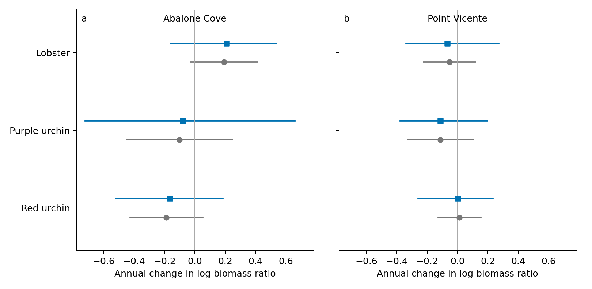

> Earlier review stage. See the [nonlinear calibration and verified Scott source delivery](../nonlinear_biomass_calibration_20261102/README.md) for the current extension and receipt status.

# Joint biomass uncertainty review

The model now fits measured sizes, survey-count uncertainty and recovery through time together. A size sample enters once. Shared sites, years and visits create covariance across the biomass estimates that depend on them. No smoothed posterior estimate is treated as an independent observation.

This is a **joint first-order Gaussian working likelihood**, not a complete uncertainty model or a manuscript update. The same seven-day sensitivity support is retained: six histories and 45 post-protection comparison-years. Researcher exclusions and unsupported biomass cells remain unchanged; no protected-site borrowing is introduced.

## What changes on the same years

| Site | Taxon | Years | Existing_review | Joint_review |
| --- | --- | --- | --- | --- |
| Abalone Cove | Red urchin | 8 | -0.188 [-0.428, 0.052] | -0.165 [-0.522, 0.183] |
| Abalone Cove | Lobster | 10 | 0.192 [-0.028, 0.411] | 0.208 [-0.161, 0.539] |
| Abalone Cove | Purple urchin | 7 | -0.102 [-0.450, 0.247] | -0.081 [-0.722, 0.658] |
| Point Vicente | Red urchin | 5 | 0.012 [-0.128, 0.152] | 0.002 [-0.262, 0.232] |
| Point Vicente | Lobster | 9 | -0.053 [-0.225, 0.118] | -0.068 [-0.339, 0.271] |
| Point Vicente | Purple urchin | 6 | -0.113 [-0.330, 0.104] | -0.114 [-0.379, 0.198] |

Both columns are annual slopes of log protected/reference biomass ratios, with intervals. The existing-review column uses HAC conditional on assigned sizes; the joint-review column estimates size variation and annual process variance together. This comparison changes the estimator and uncertainty model, not sites or survey years. Changes must not be attributed solely to wider uncertainty.

Recovery trends in the protected/reference biomass ratio for Abalone Cove (a) and Point Vicente (b). Gray circles show the existing seven-day borrowing sensitivity with conditional HAC intervals; blue squares show the joint working likelihood at calendar correlation zero with studentized bootstrap intervals. Each comparison uses identical years. Positive slopes mean increasing protected/reference biomass ratios. Interval methods differ; neither is total uncertainty. The seven-day scenario remains a review sensitivity.

## What the model assumes

Raw mean-mass observations use a lognormal sampling approximation, corrected by half the log sampling variance. Within-sample dispersion is partially pooled to avoid pretending singleton sizes are exact. Size varies with zone and calendar year, with site, site-year and visit effects within each role. Counts retain equal-date, zone and station aggregation. A first-order derivative of that aggregation links the raw measurements to annual biomass ratios; the count covariance is estimated from shared physical survey-unit resampling.

The stacked likelihood jointly estimates the size effects, recovery slope and variance components by REML. Calendar correlations of 0, 0.3 and 0.6 are fixed sensitivity scenarios, not selected by significance. Each parametric bootstrap simulates the entire joint observation vector and refits variance components. Sampling variances, count covariance, allometry and expansion weights remain conditional inputs. The process term describes recovery over observed calendar years, not a before–after protection effect.

## Checks and remaining limits

See [diagnostics](diagnostics_summary.csv), [linearization checks](linearization_checks.csv), [year influence](leave_one_count_year.csv), [variance components](variance_components.csv), and [all correlation scenarios](joint_trends.csv). Boundary variance components and influential years are reported rather than hidden. Recentring the expansion at fitted masses tests dependence on the initial approximation. The diagnostic curvature draws are conditional on fitted variance components, not a full nonlinear validation.

This implements the previously missing joint borrowed-size/process calculation in a working approximation. It does not establish protected-site transportability or estimate allometric uncertainty, count–size dependence, detection error, or unknown long-term survey-unit dependence. KFM original-size holds remain. The model is for review; primary eligibility, manuscript and supplement remain unchanged.

## Reproduce

Run `python3 code/tools/run_joint_biomass_review.py` to rebuild the model, sensitivity fits, calibration, independent checks and consolidated guide in order. Numerical checks and independent review are linked in this directory. Inputs are hashed; a completion marker is written only after all model fits finish.

## Current interpretation and verification

The biological directions are unchanged on identical years. Point estimates move by at most 0.023 log-ratio units per year. All six current HAC intervals and all six joint working intervals at rho=0 include zero. The new model has not removed a previously clear effect in these six comparisons.

The conditional simulation check covered the true slope in 18–20 of 20 datasets per setting. These small simulation counts have wide Monte Carlo uncertainty. This small exercise does not certify nominal 95% coverage; nonlinear data generation remains untested.

All 17,982 main bootstrap fits converged after checked retries; 2 needed more than one optimizer attempt. 4 simulated fits reached the computational variance bound; these are retained and flagged.

Changing the expansion center shifts slopes by at most 0.011. Removing individual count years causes larger changes, including direction changes for some short histories. Removing a reference site’s size observations tests donor influence without dropping its count history. [Simulation results](simulation_summary.csv), [size-site influence](leave_one_size_site.csv), [count centering](count_centering_sensitivity.csv), [identification](identification.csv), [independent checks](independent_checks.json), and [model equations and borrowing assumptions](MODEL.md) retain these details.

Across the alternate random seed, stronger size-variance pooling and strict timing rule, all rho=0 intervals still include zero. [Sensitivity comparison](sensitivity_comparison.csv) separates these changes.
