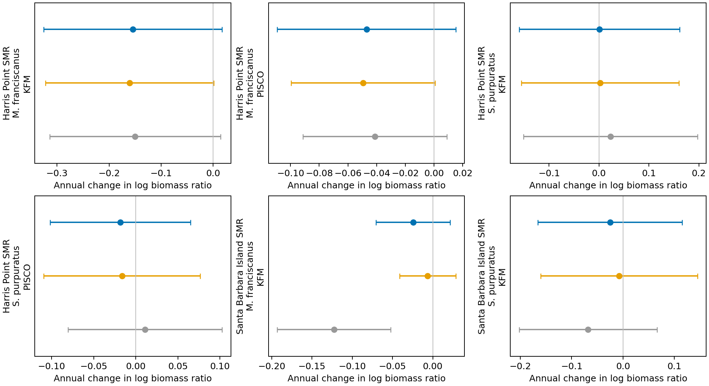

# KFM original-size reconciliation

All 54 held records reproduce Scott’s exact size-frequency distributions: Wyckoff Ledge had been combined with excluded Miracle Mile; Southeast Reef had been labeled as Southeast Sea Lion. Replacements use only Wyckoff Ledge or SE Sea Lion Rookery. All 54 have replacements. Together with 45 previously verified historical corrections and one verified zero, this resolves the donor-identity issue for all 100 affected post-protection records.

Counts, comparison years, offsets, other donors, model structure and temporal uncertainty method are unchanged. These are isolated review results; the manuscript and primary remain unchanged.

## What changes

```text
                                                  corrected_slope      low     high  n_years  original_slope  historical_only_slope  recent_increment  total_change
series_id                                                                                                                                                          
Harris Point SMR|M. franciscanus|KFM|Bio                 -0.15425 -0.32559  0.01710       18        -0.14985               -0.16047           0.00622      -0.00439
Harris Point SMR|M. franciscanus|PISCO|Bio               -0.04704 -0.10919  0.01510       15        -0.04120               -0.04947           0.00243      -0.00584
Harris Point SMR|S. purpuratus|KFM|Bio                    0.00056 -0.16004  0.16115       18         0.02314                0.00255          -0.00199      -0.02258
Harris Point SMR|S. purpuratus|PISCO|Bio                 -0.01842 -0.10187  0.06503       15         0.01098               -0.01640          -0.00203      -0.02940
Santa Barbara Island SMR|M. franciscanus|KFM|Bio         -0.02442 -0.07048  0.02165       17        -0.12253               -0.00637          -0.01805       0.09812
Santa Barbara Island SMR|S. purpuratus|KFM|Bio           -0.02522 -0.16572  0.11528       17        -0.06811               -0.00757          -0.01765       0.04289
```



Figure key: gray = original review; orange = historical corrections only; blue = all verified replacements. Bars are conditional 95% calendar-year HAC intervals. Points describe recovery through observed post-protection years, not before–after causal effects.

## Source and assumptions

Exact millimeter measurements and frequency counts are retained. Duplicate-looking source rows are not removed: the file lacks transect IDs, and retaining them reproduces the delivered frequencies exactly. Date-coerced size-bin fields are ignored. Red and purple urchin mass uses 0.00059 × size(mm)^2.917 and ^2.870 respectively, applying the transformation to individual sizes before averaging. PISCO retains its existing ≥25 mm filter. Source rows shared by histories remain the same physical observations.

KFM size/count dates match or differ by one day; both are retained under the approved survey-timing approach. This check concerns the KFM source counts, not temporal equivalence to PISCO recipients. KFM counts are quadrats while sizes are band-transect samples. Two PISCO histories still borrow KFM sizes. Santa Barbara red urchins in 2021 have only seven allowed measured animals. These support and uncertainty limitations remain; correcting site identity does not solve total biomass uncertainty.

## Reproduce

Run `python3 code/tools/reconcile_scott_kfm_sizes.py`, then `Rscript code/tools/verify_scott_kfm_refits.R`. Original workbook is preserved under `data/external/scott_gabara_2026-11-02/`; its source hash is recorded in verification.json. Row-level replacement lineage is alongside that restricted source. Public tables contain aggregate corrections. Rebuild the consolidated guide with `python3 code/tools/report_dataset_inventory.py`.
