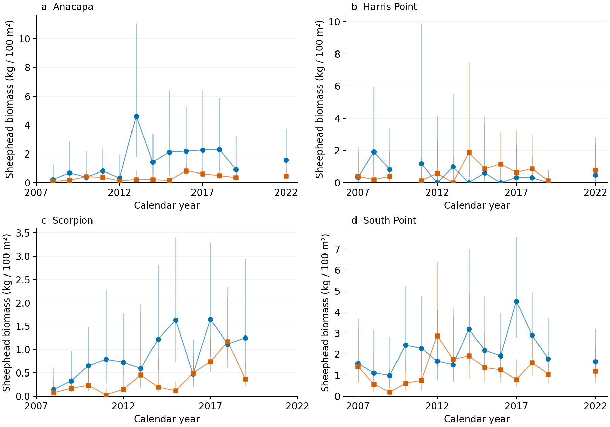
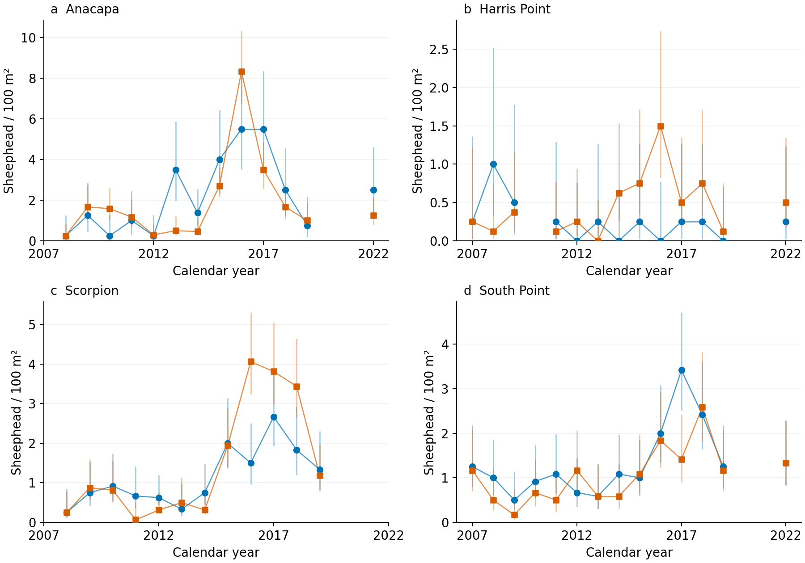

# Restricted-period KFM sheephead biomass

November 3, 2026. Review analysis only. The paper, primary results and researcher exclusions are unchanged.

## What changes

Scott’s measurements let us estimate sheephead biomass for 52 fully supported comparison-years: Anacapa 13, Harris Point 13, Scorpion 12 and South Point 14, within 2007–2022. These are post-protection trends, not before–after effects. No missing year is interpolated. The five additional years that looked supported at the annual level have at least one visit without matching sizes; density remains valid in those years. See the visit-level loss ledger.

Anacapa has an increasing protected–reference biomass difference. Scorpion changes from a declining density difference to a modestly increasing biomass difference on the same observations. Harris Point remains negative, and South Point is weakly positive. These are conditional review estimates, not evidence that protection caused the differences.

## Same sites and years

The table reports annual changes in the protected minus reference mean. Density uses fish/100m²/year; biomass uses kg/100m²/year. They are different units and their magnitudes should not be compared directly. Biomass_count_only holds measured mean fish mass fixed; biomass propagates count and size uncertainty together. Bounds here use a small-sample t reference, with process variance estimated by REML.

| MPA | response | n_years | slope | lower | upper |
| --- | --- | --- | --- | --- | --- |
| Anacapa Island SMR 2003 | density | 13 | 0.092 | -0.062 | 0.247 |
| Anacapa Island SMR 2003 | biomass_count_only | 13 | 0.107 | 0.036 | 0.178 |
| Anacapa Island SMR 2003 | biomass | 13 | 0.093 | -0.015 | 0.201 |
| Harris Point SMR | density | 13 | -0.039 | -0.102 | 0.024 |
| Harris Point SMR | biomass_count_only | 13 | -0.047 | -0.152 | 0.058 |
| Harris Point SMR | biomass | 13 | -0.034 | -0.153 | 0.086 |
| Scorpion SMR | density | 12 | -0.100 | -0.236 | 0.036 |
| Scorpion SMR | biomass_count_only | 12 | 0.033 | -0.051 | 0.117 |
| Scorpion SMR | biomass | 12 | 0.032 | -0.036 | 0.100 |
| South Point SMR | density | 14 | -0.013 | -0.078 | 0.052 |
| South Point SMR | biomass_count_only | 14 | 0.033 | -0.084 | 0.150 |
| South Point SMR | biomass | 14 | 0.010 | -0.104 | 0.124 |

Adding size uncertainty changes GLS weights as well as intervals. The separate equal-year slopes preserve identical year weights: Anacapa biomass increases, Harris declines, Scorpion changes from a density decline to a small biomass increase, and South Point changes little. The counts-only versus joint biomass point estimates in that equal-year calculation are identical. This separates the biological size contribution from precision weighting.

## How uncertainty was handled

- Match the existing sheephead count roster and response-specific researcher exclusions. Restrict variance calibration to those same physical site-years; excluded sites cannot supply calibration information.
- Pair counts and sizes by visit, allow same-site size measurements within seven days, multiply within visits, then aggregate with the original count-record weights and equal site weights. Extra unmatched size visits do not enter biomass. No cross-site or cross-year borrowing is used. A reused size visit has one shared uncertainty draw across its count visits.
- Require sizes for every count visit, including visits with zero counts, because underlying abundance is uncertain even when no fish was counted. Observed zero values remain zero in point estimates. A missing size does not remove the valid density history.
- Use a quasi-Poisson Gamma rate calculation for count uncertainty, calibrated to within-visit count dispersion in the retained cohort. A Gamma shape increment of 0.5 permits uncertainty at observed zeros; 0.1 is checked separately. With dispersion 1.129, these equal 0.5645 and 0.1129 raw-count equivalents. These are conditional sampling assumptions, not estimates of detection probability.
- Resample source size-record weights while retaining grouped fish frequencies. Apply the existing fixed mass–length equation 0.0144×length^3.04. Regularize sparse size variance using two pseudo-records of within-cohort dispersion; four is a sensitivity. There is no independent replication of the roving dive.
- Propagate the nonlinear product in 4,000 joint draws. The main calculation assumes conditional independence of count and size errors. Positive and negative dependence scenarios preserve marginal draws and impose Gaussian-copula correlation ±0.5; they are sensitivity assumptions, not measured correlations.
- Fit the annual protected–reference difference with known estimated sampling covariance plus annual process variance. Calendar correlations 0,0.3 and0.6 are checked. All years retain their actual calendar spacing. Also test constant station membership, the near-date matches, source length-range endpoints and leaving out each year.

## How strong is the evidence?

All four main t intervals include zero. Anacapa’s 499-refit conditional studentized bootstrap interval narrowly excludes zero; this discrepancy is reported, not used to select the favorable interval. All four main biomass fits estimate the extra annual process variance at its zero boundary. Estimated sampling covariance, sparse-pool regularization and a short time series can therefore drive apparent precision. The bootstrap conditions on that estimated sampling covariance; it is not a calibrated full generative model of counts and sizes. Do not describe the Anacapa result as robustly significant or promote these intervals to primary results.

Roving fish-size surveys and visual count transects may sample different fish, depths or habitats. Year-omission checks retain the Anacapa, Harris and Scorpion directions; South Point crosses zero. Constant station membership preserves the main qualitative conclusions. Residual normality checks do not flag these short series, but have low power. This uncertainty, observer effects, allometric coefficient uncertainty and unknown repeated-survey dependence are not measured by these intervals. Fixed station membership and count–size dependence sensitivities help assess consequences but cannot validate the sampling footprint. Scott’s new reference-site concerns remain a separate unresolved review; the existing fish exclusions are preserved, not replaced by benthic exclusions.

## Recommendation

Keep density as the full-history primary KFM sheephead response. Retain this matched-period biomass analysis as supporting evidence for review: fish size can change the recovery pattern, particularly at Scorpion, but these data do not establish a consistent biomass increase across all four comparisons. Resolve roving-versus-transect representativeness and reference suitability before promoting KFM biomass. No manuscript revision is justified solely by a favorable conditional interval.

## Figures and tables

Blue circles are protected sites; orange squares are references. Points are observed count × measured-size estimates, averaged within the stated cohort. Vertical intervals are conditional sampling draws, including counts and sizes for biomass; they exclude annual process and unmeasured method uncertainty. Lines join adjacent surveyed years only. Panels a–d are Anacapa, Harris Point, Scorpion and South Point. No figure titles, subtitles or embedded legends.

Density on exactly the same supported site-years. Symbols and interval interpretation match the biomass figure. Gamma uncertainty intervals need not be centered on observed point estimates, especially at zero counts.

- [Trend estimates and all timing/station/correlation scenarios](trends.csv)
- [Equal-year estimates separating reweighting](equal_year_slopes.csv)
- [Count, sparse-pool and dependence assumptions](assumption_sensitivity.csv)
- [Annual estimates and membership](annual_responses.csv)
- [Visit matching and weights](visit_support.csv)
- [Five comparison-years lost after visit matching](lost_comparison_years.csv)
- [Source size rows used](size_record_use.csv)
- [Variance-calibration membership](variance_calibration_membership.csv)
- [Year eligibility and expected membership](year_eligibility.csv)
- [Leave-one-year results](leave_one_year.csv)
- [Bootstrap diagnostics](bootstrap_diagnostics.csv)

## Reproduce

Run `python3 code/tools/run_kfm_sheephead_biomass_review.py` for the complete ordered rebuild and checks. To run individual components, run code/tools/kfm_sheephead_biomass_review.py, then repeat with --variant empirical --count-model empirical; --variant pool_strength4 --pool-strength 4; --variant count_prior01 --count-prior 0.1; --variant dependence_positive --dependence 0.5; and --variant dependence_negative --dependence -0.5 (separate each option from its value with a space). Finally run code/tools/report_kfm_sheephead_biomass.py. Input paths and hashes are in inputs.json; numerical assumptions and seed in run.json. No external email action or primary input replacement occurs.
