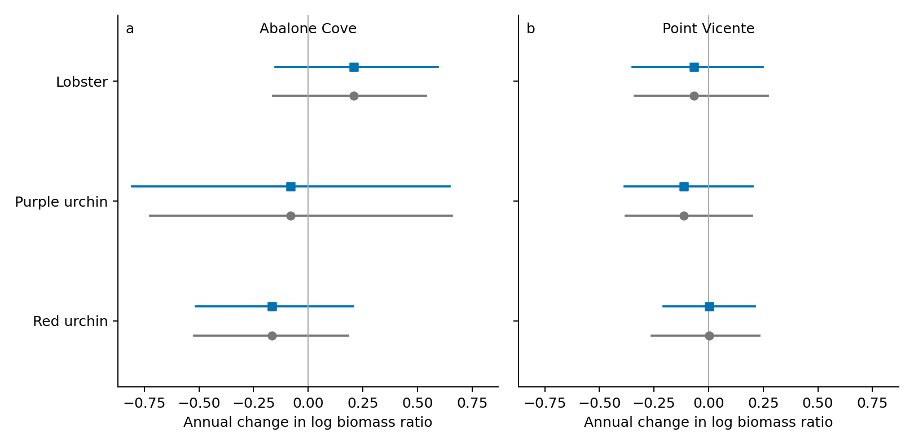

# Nonlinear biomass calibration

The same six PISCO histories and 45 post-protection comparison-years are retained. Researcher exclusions and unsupported biomass cells are unchanged. This review tests the approximation used to combine sizes and densities; it does not update the paper or primary analysis.

## What changes

| Site | Taxon | Initial | Iterated | Change | Initial_interval | Calibrated_interval |
| --- | --- | --- | --- | --- | --- | --- |
| Abalone Cove | Red urchin | -0.165 | -0.165 | +0.001 | [-0.522, 0.183] | [-0.516, 0.207] |
| Abalone Cove | Lobster | 0.208 | 0.207 | -0.001 | [-0.161, 0.539] | [-0.152, 0.593] |
| Abalone Cove | Purple urchin | -0.081 | -0.082 | -0.001 | [-0.722, 0.658] | [-0.806, 0.647] |
| Point Vicente | Red urchin | 0.002 | 0.010 | +0.009 | [-0.262, 0.232] | [-0.207, 0.212] |
| Point Vicente | Lobster | -0.068 | -0.065 | +0.002 | [-0.339, 0.271] | [-0.349, 0.249] |
| Point Vicente | Purple urchin | -0.114 | -0.113 | +0.001 | [-0.379, 0.198] | [-0.384, 0.203] |

Initial and iterated values are annual slopes of the protected/reference biomass log ratio. Iteration updates the expansion around fitted sizes while preserving observations and sampling covariance; it is an approximation check, not an exact nonlinear likelihood. Calibrated intervals apply the existing fitting procedure to simulated nonlinear observations. They are not intervals from the iterated fit.

Protected/reference biomass recovery slopes at Abalone Cove (a) and Point Vicente (b), on unchanged years. Gray circles show the existing joint-model interval; blue squares show conditional pivot intervals calibrated with exact arithmetic biomass aggregation, simulated individual-mass means and empirical count-unit resampling. Both markers show the same original fitted slope to isolate interval changes. Iterated point estimates are reported separately in the table. Calendar correlation is zero here; correlation 0.6 is retained in the linked results. These are diagnostic conditional intervals, not a full nonlinear fit or total uncertainty.

## What was tested

Each comparison is simulated at calendar correlations 0 and 0.6, keeping the observed years and fitted nuisance parameters. Three paired branches share the same latent size effects and annual process draws:

- Gaussian working observations reproduce the current model and provide a control.
- Exact mass aggregation replaces the first-order size approximation, with the same Gaussian measurement errors. The paired difference isolates curvature.
- Exact mass aggregation plus sample/count resampling also simulates individual masses from a lognormal distribution with the fitted arithmetic mean and pooled dispersion, averages the observed number of individuals, and resamples physical count units. Sizes enter once, shared effects remain shared, and biomass is multiplied and aggregated exactly. Known zero-count visits remain zero.

All branches refit the current joint working model. Half of each simulation set calibrates its pivot quantiles and the other half checks those quantiles on independent draws. Existing Gaussian pivot quantiles are also checked against the nonlinear draws. Monte Carlo bounds are reported. This conditional check is not a nested validation of the complete interval-fitting procedure over unknown parameter values.

The nonlinear count contribution is an observation-level residual around the existing count design. It does not regenerate new sites, missing surveys, eligibility decisions or a complete raw-data count process. Expansion weights and estimated sampling variances remain fixed during calibration; the separate observed-data iteration tests expansion sensitivity. Thus this extends nonlinear calibration without claiming that every stage of the original pipeline has been simulated.

## Scott's source delivery

Scott Gabara supplied **KFM Nat Hab Red Purp 2012-2022.xlsx** on November 2. The unchanged workbook is preserved locally with SHA256 `c1bf620b67543bbb0f92b74c6247d3949e03fbc1e7a9d998f1e83b1836fa088e`. It has 55,142 nonempty rows, 33 site names, exact millimeter sizes and frequency counts. Actual years are 2012–2019 and 2021–2022; there are no 2020 records. Distinct Southeast Reef/SE Sea Lion Rookery and Miracle Mile/Wyckoff Ledge labels are present. Some bin labels were converted to Excel dates; the exact-size column must be used.

Receipt is now resolved. Matching these records to the held count histories and original site IDs remains necessary; no KFM biomass hold is cleared by receipt alone. The workbook contains red/purple urchins, not lobster or sheephead. No reply was sent. [Receipt record](kfm_source_receipt.json).

## Interpretation limits and reproduction

Allometry, estimated sampling dispersion, offsets, the observed count-unit population and support are conditional. Lognormal individual masses are a working assumption. Detection, count–size dependence, unobserved animals at zero-count visits, protected-site transportability, cross-history covariance and broader missing-data mechanisms remain untested. This is calibration of the existing estimator, not a newly fitted full nonlinear likelihood or total uncertainty.

Run `python3 code/tools/run_nonlinear_biomass_review.py`. [Paired bias changes](paired_bias_changes.csv), [calibration coverage](calibration_summary.csv), [iteration trace](iteration_trace.csv), [nonlinear components](nonlinear_components.csv), [checks](checks.json), and [consolidated guide](../dataset_inventory_20261101/README.md) retain details.

## Verified summary

Observed expansion iteration converged in 6 of six rho=0 histories. The largest slope change was 0.0086. The exact-generation calibrated interval width relative to the previous interval ranged from 0.85 to 1.06. See the table for any sign or interval changes; near-zero estimates should not be treated as directionally established.

The largest simulated incremental bias relative to the paired Gaussian control was 0.0153 per year, for Point Vicente purple urchins. This is evidence about estimator bias under the specified generator, not a directly observed biological change. The linked comparison includes an incremental-bias-adjusted diagnostic; no correction has been adopted for the paper.

All 35,964 paired refits completed; 10 required optimizer retries. 21 simulated fits reached the variance bound and remain flagged in the results; no failed fit was substituted or silently dropped.

The independent split check for the combined nonlinear branch covered 93.0%–97.2% across histories/correlation scenarios. The lowest split coverage was Point Vicente red urchins at correlation zero (93%). Finite calibration quantiles and validation draws both add Monte Carlo uncertainty; do not label all settings validated at nominal 95%. These results concern conditional pivot calibration and do not certify the full data-generating process.
